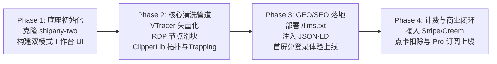

# AI-SVG-Generator 产品需求文档 (PRD)

| 文档版本 | 状态 | 撰写日期 | 目标交付物 |
| :--- | :--- | :--- | :--- |
| **v1.0.0** | **已定稿 (Ready for Dev)** | 2026-11-05 | 全栈 AI 矢量生成与物理切刻优化 SaaS |

---

## 1. 项目背景与定位 (Product Vision)

### 1.1 市场机遇
根据 Google Trends 实时数据，`AI SVG Generator` 及其相关词（`png to svg`, `svg converter free`）正处于 **Breakout（爆发性增长 >5,000%）** 阶段。然而，市面上绝大多数通用大模型（Midjourney、DALL-E）输出的均为像素位图，现有矢量描摹工具则普遍产生**“节点面条（Node Soup）”**和**“未闭合路径”**，导致 Cricut 切刻机和激光雕刻机频繁死机毁料。标杆工具 Vectorizer.ai 转向 \$9.99/月 后，全网用户正在强烈寻找高性价比、免强制注册的替代品。

### 1.2 核心价值主张 (Value Proposition)
* **产品标语**：*“No Node Soup. 100% Cricut & Web Ready.”*（告别节点面条，专为切刻机与前端打造的纯净矢量生成器）
* **差异化护城河**：
  1. **免登录即刻试用（No Sign-Up Frictionless Trial）**：破除市面套壳站强制注册墙；
  2. **物理级几何清洗（Toolpath Ready）**：100% 路径闭合、无自相交、智能去除抗锯齿毛边；
  3. **Cricut 自动分色分层 + 补漏白（Trapping）**：一键生成分色复合路径，解决物理热转印露白痛点；
  4. **极简 Web 代码直出**：面向开发者提供无元数据污染的纯净 React/JSX 与 CSS 动效代码。

---

## 2. 目标用户画像与使用场景 (User Personas)

| 用户群体 | 典型身份 | 核心使用场景 | 核心付费驱动力 |
| :--- | :--- | :--- | :--- |
| **Persona 1: POD / 创客群体 (核心商业来源)** | Etsy 卖家、Cricut/激光切割玩家、T恤印花定制商 | 将手绘稿或 AI 设计转为可物理切割的多色 SVG 素材包 | **直接商业变现 (ROI)**。能顺利导入 Cricut Design Space 且切纸刀不卡死，单套素材卖 \$4.99 出两单即回本。 |
| **Persona 2: 独立开发者 / 全栈工程师** | Indie Hackers、前端工程师、SaaS 开发者 | 为网站制作 Landing Page 配图、UI 图标、动态图表 | **极致开发效率**。一键复制干净的 React/Tailwind 代码，体积小（<5KB）。 |
| **Persona 3: UI/UX 设计师** | Figma / Illustrator 商业接单人员 | 制作矢量 Logo 原型、扁平插画素材 | **极低二次编辑成本**。节点数量少，手柄锚点平滑可控。 |
| **Persona 4: 偶发散客** | 学生、个人站长、DIY 礼品制作者 | 偶尔制作单个图标或转一张家庭照片做纪念品 | **无月租门槛**。抗拒按月扣费，青睐单次便宜的点卡购买。 |

---

## 3. 核心功能与架构规范 (System Specifications)

系统采用解耦的**双轨制生成引擎架构**，基于 `E:\SaaS-template\shipany-two` 全栈模板构建：

```
                                  ┌── 用户输入 (Prompt / Image) ──┐
                                  │                               │
                                  ▼                               ▼
                     【轨道 A：开发者 UI/动效引擎】     【轨道 B：物理级切刻/POD 引擎】
                                  │                               │
                        GPT-6.2 Astra 原生直出        高对比度 Diffusion 生图 / 用户位图
                                  │                               │
                            语义化 XML 生成             Step 1: 图像预处理 (去抗锯齿/硬化)
                                  │                               │
                         SVGO 压缩与属性抽取            Step 2: 轮廓追踪与矢量化 (VTracer)
                                  │                               │
                      代码转换 (JSX/Vue/Tailwind)       Step 3: 几何拓扑清洗 (ClipperLib)
                                  │                               │
                                  │                     Step 4: 补漏白算法 (Trapping/Choke)
                                  │                               │
                                  │                     Step 5: 分色复合路径打组 (Compound Path)
                                  │                               │
                                  ▼                               ▼
                          [极简前端代码组件]               [100% Cut-Ready 物理级 SVG]
```

### 3.1 前端核心交互工作台 (The Studio Canvas)
* **双模式输入切换（Tabs）**：
  * **Tab 1: Text-to-SVG**：输入自然语言提示词（预设风格：极简图标、Cricut 单色、多色扁平插画）；
  * **Tab 2: Image-to-SVG**：支持拖拽上传 PNG/JPG/WebP 位图，支持裁剪与纯色背景消除。
* **实时矢量画布（Interactive Canvas）**：
  * 真实渲染 SVG 图元，支持滚轮平移无损放大（$10\%\sim 1600\%$）；
  * **锚点可视化开关**：一键点亮贝塞尔控制点，向用户直观展示“干净低节点”的品质优势。
* **参数调优控制台**：
  * **节点精简度滑块（Smoothness Slider）**：动态调节 RDP 容差值 $\epsilon$，实时显示“当前节点数：85（已精简 82%）”；
  * **色彩图层面板（Layers & Palette）**：自动提取 $K$ 种主色，支持单个图层眼睛图标隐藏/显示，支持点击拾色器直接换色。
* **多格式交付与导出（Export Center）**：
  * **Cricut 专用 SVG**：强制剔除 `<style>` 与动画，内联属性，分色合并复合路径；
  * **Web 极简 SVG**：经过 SVGO 压缩的纯净 XML；
  * **React JSX / Vue**：一键复制代码组件；
  * **PNG/PDF**：高分辨率光栅化导出。

### 3.2 后端清洗与算法管线 (Geometry Engine)
* **色彩量化与抗锯齿消除**：使用 CIELAB 空间 K-Means 聚类与 Otsu 自适应二值化，抹平半透明过渡边缘；
* **高精度曲线追踪**：基于 Rust VTracer 执行三次贝塞尔曲线拟合；
* **几何拓扑物理修复（ClipperLib）**：
  * 强制追加 `Z` 指令闭合路径；
  * 布尔并集（Union）消除自相交微回路（Self-loops）；
  * 剔除长度小于 $0.5\text{mm}$ 的细碎杂乱噪点。
* **物理补漏白算法（Vector Trapping）**：对相邻色块执行向外膨胀偏移（`Offset = +0.2mm ~ +0.5mm`），彻底解决热转印缩水接缝露白问题。

---

## 4. 首页设计与 GEO / SEO 实施规范

### 4.1 关键词矩阵布局 (Search Intent Mapping)
根据 Google 下拉联想词与飙升趋势，首页必须对齐以下词根：
* **Title**: `Free AI SVG Generator Online: Text & PNG to SVG (No Sign-Up Needed)`
* **H1**: `The True AI SVG Generator: No Node Soup, 100% Cut & Web Ready`
* **H2-1**: `High-Precision PNG to SVG AI Converter (Instant & Clean)`
* **H2-2**: `Cut-Ready Layered SVGs for Cricut, Silhouette & Laser Machines`
* **H2-3**: `Lightweight SVG Code Generator for React & Web Developers`

### 4.2 GEO (生成式引擎优化) 专项规范
为确保 SearchGPT、Perplexity、Google AI Overviews 优先引用本产品：
1. **根目录部署 `/llms.txt`**：提供清晰定义句、产品特性、与 Inkscape/Vectorizer 对比 Markdown；
2. **`robots.txt` 明确放行**：显式放行 `GPTBot`, `OAI-SearchBot`, `PerplexityBot`, `ClaudeBot`, `Google-Extended`；
3. **服务端渲染（SSR/SSG）优先**：核心论点、对比表格、FAQ 必须直接在 Raw HTML 中纯文本直出；
4. **注入结构化数据（JSON-LD）**：
   * `SoftwareApplication`（标记为设计类免费试用 WebApp）；
   * `FAQPage`（将 `free no sign up`, `node soup`, `cricut layers` 写成权威问答）。

---

## 5. 商业化模式与计费策略 (Monetization Funnel)

采用 **Product-Led Growth (PLG)** 漏斗，平衡“免费免登录获客”与“商业生产力变现”：

```
┌────────────────────────────────────────────────────────────────────────┐
│ 1. 匿名免登录试用 (Top of Funnel - 解决 "No Sign-Up" 搜索诉求)         │
│    - 无需注册，每日 2 次免费生成 / 转换                                 │
│    - 网页画布完整预览、节点缩放检查、单色标准 SVG 下载                 │
├────────────────────────────────────────────────────────────────────────┤
│ 2. 散客点卡包 (Pay-As-You-Go - 截胡搜 "Free" 但有偶发需求的手工散客)   │
│    - $4.99 购买 20 个高精度导出点数                                     │
│    - 永久有效，支持导出 Cricut 分色包与高精度矢量                       │
├────────────────────────────────────────────────────────────────────────┤
│ 3. Pro 专业订阅 (Subscription - 收割 Etsy / POD 店主与职业开发者)      │
│    - $9.9 / 月 或 $69 / 年                                              │
│    - 无限次高速转换、批量生成、商用授权、优先去除自相交与 Trapping 补漏白│
└────────────────────────────────────────────────────────────────────────┘
```
* **支付底层**：直接接入底座模板内嵌的 **Stripe / PayPal / Creem**（复用 `src/extensions/payment`）。

---

## 6. 系统底座工程规范 (Template Integration Plan)

项目严格基于 `E:\SaaS-template\shipany-two` 进行初始化：

| 底座模块 | 对应工程目录 | 本项目复用与定制方案 |
| :--- | :--- | :--- |
| **全栈框架** | `src/app` | Next.js App Router (SSR)，用于极速首屏与 GEO 渲染 |
| **AI 驱动** | `src/extensions/ai` | 复用封装好的 API 客户端：Track A 接 LLM 直出；Track B 接 Replicate/Fal 生图 |
| **持久存储** | `src/extensions/storage` | 复用 `r2.ts`（Cloudflare R2），存放用户位图与生成的 `.svg` 文件 |
| **计费点数** | `src/extensions/payment` | 复用 `stripe.ts`、`creem.ts` 实现点卡扣减与订阅 Webhook 同步 |
| **用户认证** | `src/core/auth` | Better-Auth（Google 一键登录 + 邮箱验证码） |
| **全球多语言** | `src/core/i18n` | `next-intl`，国际化收割欧美多语种 Cricut 搜索流量 |
| **UI 基础库** | `@radix-ui/...` | Tabs (双模式切换), Slider (节点滑块), Accordion (图层与FAQ), Dialog (付费弹窗) |

---

## 7. 研发实施路线图 (Development Roadmap)



1. **第一阶段：基建就绪与 UI 原型**
   * 将 `E:\SaaS-template\shipany-two` 迁移至当前工作区；
   * 实现首屏“文本生矢量 / 图片转矢量”双标签交互与 SVG 实时渲染画布。
2. **第二阶段：核心几何管线打通**
   * 接入 VTracer 核心追踪与色彩量化；
   * 实现前端滑块与后端 RDP 节点精简联动；
   * 落地 ClipperLib 闭合检查与 Trapping 补漏白逻辑。
3. **第三阶段：GEO / SEO 套件部署**
   * 根目录部署 `/llms.txt`；
   * 注入 `SoftwareApplication` 与 `FAQPage` 结构化标记；
   * 配置首屏免登录试用逻辑与防刷限流机制。
4. **第四阶段：计费与交付闭环**
   * 配置 Stripe / Creem 点卡包与 Pro 订阅；
   * 完成 Cricut 专用分色复合路径导出功能的端到端测试。

